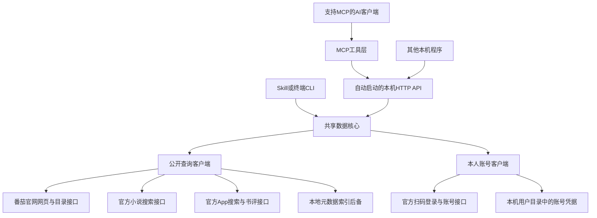

# 番茄小说：MCP、独立 Skill 与本地 API

[](LICENSE)
[](https://github.com/fysh1010/mcp-server-fanqie/stargazers)

搜索番茄作品、查看小说目录和网站可见正文、读取书评；本人扫码登录后，还可以读取自己的书架、阅读进度和收藏划线原文。

**当前版本：`0.2.0-dev.6`，GitHub开发预览版。** 默认使用本机运行的数据核心，直接请求番茄官方站点，已取消对旧第三方开放API的默认依赖。独立Skill包含全部必需运行代码，只需要Node.js 22+和网络；MCP需要安装项目依赖。

[下载本版](https://github.com/fysh1010/mcp-server-fanqie/releases/tag/v0.2.0-dev.6) · [详细安装与使用](docs/USAGE.md) · [全部方法清单](docs/FUNCTIONS.md) · [HTTP接口文档](server/README.md)

> 本版发布到GitHub，未发布npm registry。不要用旧说明中的 `npx -y @fysh925/mcp-server-fanqie` 安装方式判断本版能力：registry里的旧包仍是旧架构。请使用本仓库源码或本版Release附件。

## 三种使用方式

- **MCP**：为支持 MCP 的 AI 客户端提供番茄搜索、阅读和本人账号数据查询。当前开发预览版请按[使用指南](docs/USAGE.md)从源码或 Release 安装。
- **独立 Skill**：在支持 Skill 和 Node.js 22+ 的客户端中使用，技能目录包含独立运行文件。安装方法见[使用指南](docs/USAGE.md#skill-安装)。
- **DeepSeek Harness 插件**：在右侧栏搜索、查看封面和目录、阅读网站可见章节；本人扫码后查看书架和收藏划线，并提供对话工具。详见[插件文档](plugins/deepseek-harness/README.md)。

DeepSeek Harness 插件是独立包 `dsh-fanqie-reader`；它与上文提到的 MCP 包 `@fysh925/mcp-server-fanqie` 是不同的 npm 包。插件当前支持的媒体范围和账号使用方式见插件文档。

## 为什么重做：从第三方服务迁移到本地实现

旧版0.1.x的主要职责是把第三方服务封装成14个MCP工具，默认请求 `http://101.35.133.34:5000`。搜索、目录、正文和设备管理等能力由该第三方服务器提供。第三方地址不可用后，MCP工具虽然仍能列出，实际查询也会随之失效。

本次把数据获取实现放进项目本身：

- **本地实现公开查询**：搜索、书籍详情、目录、网站可见章节、书评正文，直接访问官方入口。
- **同时提供MCP和独立Skill**：两种入口共用核心，Skill不需要另外启动HTTP服务，也不依赖仓库外的运行代码。
- **新增本人账号能力**：扫码登录、当前书架、云端阅读位置、收藏划线原文及翻页。
- **补齐使用与错误处理**：目录分页、分类搜索游标、完整书评文本、故障重试、限流提示及本地索引后备。
- **明确能力边界**：保留旧路径方便迁移，未实现的功能返回501；不把工具名称还存在当作功能已经完成。

本版解决的是旧第三方API这一中间依赖，仍需要联网访问番茄官方站点。官方接口、网页结构、字体或匿名设备规则变化后，仍可能需要维护。

## 对比旧第三方服务：本次实现了什么

“旧版范围”以仓库0.1.x的[README](https://github.com/fysh1010/mcp-server-fanqie/blob/ce0019c/README.md)和API封装为依据，只说明当时声明或转发了什么，不代表现在还可验证旧服务，也不保证新旧返回字段逐项相同。

| 能力 | 旧版第三方依赖范围 | 当前MCP | 当前Skill | 本版实际行为与边界 |
| --- | --- | --- | --- | --- |
| 小说关键词搜索 | 转发第三方搜索 | 支持 | 支持 | 官方免签名搜索，支持offset翻页 |
| 听书搜索 | 转发第三方分类搜索 | 支持 | 支持 | 官方App只读搜索，本地生成签名 |
| 漫画搜索 | 转发第三方分类搜索 | 支持 | 支持 | 仅搜索与基本元数据；可能混入推荐 |
| 短剧搜索 | 转发第三方分类搜索 | 支持 | 支持 | 仅搜索与基本元数据；支持cursor翻页 |
| 小说详情 | 转发第三方详情 | 支持 | 支持 | 从官网页面数据提取规范化字段 |
| 分卷目录 | 转发第三方完整目录 | 支持 | 支持 | 默认每页50章，上限200章 |
| 简化目录 | 转发第三方简化目录 | 支持 | 使用directory | MCP/API可只返回标题与ID |
| 单章小说正文 | 转发第三方内容 | 部分支持 | 部分支持 | 网站可见正文；不保证与App全文一致 |
| 批量小说正文 | 转发第三方批量接口 | 支持 | 支持 | 每批最多20章，逐章校验书籍归属 |
| 原始章节数据 | 转发第三方原始内容 | 支持 | 支持 | 官网章节字段及解析正文 |
| 书评正文与翻页 | 旧文档声明评论列表 | 支持 | 支持 | 保留正文、评分、点赞、回复数及cursor；这里只读取整本书的书评 |
| 章评、段评、楼中楼正文 | 旧文档对评论范围有宽泛描述 | 未实现 | 未实现 | 不把书评当作其他评论类型 |
| 听书音频播放 | 旧统一内容接口声明支持 | 未实现 | 未实现 | 搜索可用，音频内容未接入 |
| 短剧视频播放 | 旧统一内容接口声明支持 | 未实现 | 未实现 | 搜索可用，视频内容未接入 |
| 漫画图片、下载任务与进度 | 旧统一内容与任务接口声明支持 | 未实现 | 未实现 | 任务进度兼容入口返回501 |
| 整本下载 | 旧统一内容接口声明支持 | 未实现 | 未实现 | 可按目录批量查询，未提供整本任务或导出 |
| Android设备注册、设备池 | 旧版依赖服务端设备管理 | 未实现真实管理 | 无命令 | 两个状态工具只返回网页模式说明；注册返回501 |
| iOS注册及专用正文 | 旧版依赖iOS服务 | 未实现 | 无命令 | 保留接口，返回501 |
| 本人扫码登录与本地退出 | 原14个工具未提供 | 新增 | 新增 | 手机本人确认，凭据只保存在本机 |
| 本人书架及阅读位置 | 原14个工具未提供 | 新增 | 新增 | 当前书架、云端可用阅读记录及当前章节 |
| 有收藏的书及数量 | 原14个工具未提供 | 新增 | 新增 | 划线数、书签数、笔记数 |
| 本人收藏划线原文 | 原14个工具未提供 | 新增 | 新增 | 原文、章节、位置、修改时间与cursor翻页 |
| 独立撰写的笔记/想法正文 | 原14个工具未提供 | 未实现 | 未实现 | 可读笔记数量，尚不读取笔记正文 |
| 本地元数据索引 | 原14个工具未提供 | 无专用工具 | 新增 | 通过CLI/API导入和刷新，小说搜索故障时明确标记降级 |

**结论：本版覆盖了公开搜索、书评、小说网站阅读和个人阅读数据的当前需求，并未完整复刻旧服务的音视频、漫画内容、设备池、iOS或整本下载能力。**

## 当前MCP与Skill能调用哪些方法

以下Skill命令均由技能目录内的 `scripts/fanqie.mjs` 执行。源码用户可使用 `node "server/cli.mjs" <命令>`。

### 公开查询，无需账号登录

| MCP工具 | Skill/CLI命令 | 用户可以做什么 |
| --- | --- | --- |
| `search_books` | `search` | 搜索小说、听书、漫画、短剧；关键词与分类保持不变继续翻页 |
| `get_book_detail` | `detail` | 查看书名、作者、简介、字数及最新章节等 |
| `get_book_directory` | `directory` | 分页查看含分卷信息的章节目录 |
| `get_simple_directory` | 无独立命令，可使用directory | 获取简化的章节标题、ID列表 |
| `get_chapter_content` | `chapter` | 读取一个网站可见章节 |
| `get_content` | `chapter` / `batch` | 统一单章与批量正文入口，每批最多20章 |
| `get_raw_content` | `raw` | 查看原始章节数据及解析后的正文 |
| `get_comments` | `comments` | 获取整本书的书评正文、评分、点赞数和回复数 |

### 本人账号，需要扫码授权

| MCP工具 | Skill/CLI命令 | 用户可以做什么 |
| --- | --- | --- |
| `start_account_login` | `login-start` | 获取本人登录二维码 |
| `poll_account_login` | `login-poll` | 检查扫码、确认和登录完成状态 |
| `get_account_status` | `account-status` | 检查本地账号登录是否有效 |
| `get_my_bookshelf` | `bookshelf` | 查看当前官方书架及已同步的阅读位置 |
| `get_my_reading_progress` | `reading-progress` | 查看云端阅读记录、书名、当前章节，可筛选一本书 |
| `get_my_highlight_books` | `highlight-books` | 查找有收藏记录的书及划线、书签、笔记数量 |
| `get_my_highlights` | `highlights` | 分页读取自己收藏的划线原文及位置 |
| `logout_account` | `logout` | 清除本机该配置的凭据，不更改官方书架、进度或收藏 |

### 辅助与兼容方法

| MCP工具 | Skill/CLI命令 | 实际作用 |
| --- | --- | --- |
| 无 | `index-import` | 从官网录入指定书籍的元数据 |
| 无 | `index-refresh` | 刷新官网首页可发现的书籍索引 |
| 无 | `capabilities` | 查看当前能力清单 |
| 无 | `help` | 显示命令和参数帮助 |
| `get_device_pool_status` | 无 | 返回网页模式说明，不管理真实设备池 |
| `get_device_status` | 无 | 返回网页模式说明，不验证真实App设备 |
| `register_device` | 无 | 尚未实现，返回501 |
| `get_ios_content` | 无 | 尚未实现，返回501 |
| `register_ios_device` | 无 | 尚未实现，返回501 |
| `get_manga_progress` | 无 | 尚未实现，返回501 |

MCP共注册22个工具，其中16个公开查询/本人账号工具、2个状态兼容工具、4个未实现工具。Skill/CLI有19个命令，含help和capabilities。参数、HTTP路径及边界见 [完整清单](docs/FUNCTIONS.md)。

## 我们如何实现

旧版调用链是“AI客户端 → MCP封装 → 第三方开放API → 数据”。本版默认调用链如下：



### 数据来源与处理方式

| 模块 | 实现方式 | 主要代码 |
| --- | --- | --- |
| 小说搜索 | 请求官方 `novel.snssdk.com` 轻量搜索；失败时尝试官网后备和有限本地索引；降级结果明确标记范围 | `server/core.mjs`、`server/local-index.mjs` |
| 听书/漫画/短剧搜索 | 请求 `reading.snssdk.com/reading/bookapi/search/tab/v`，按book_data/video_data解析类别；保留官方推荐标记与翻页游标 | `server/app.mjs`、`server/core.mjs` |
| 书评正文 | 请求官方commentapi只读列表，保留完整文本和分页会话；不在客户端截断正文 | `server/core.mjs`、`server/app.mjs` |
| 本地请求签名 | 使用Node原生加密实现签名，无需公共签名服务；MIT来源及许可随包附带 | `server/sign.mjs`、[第三方说明](THIRD_PARTY_NOTICES.md) |
| 小说详情 | 读取官网页面的JSON初始数据，直接解析，不执行页面脚本 | `server/core.mjs` |
| 目录和网站正文 | 目录走官网接口；章节提取可见数据，使用已知字体映射转换字符；锁定、未知字体或残余乱码明确报错 | `server/core.mjs`、`src/fontDecrypt.ts` |
| 扫码与会话 | 官方二维码、本人手机确认、手动保留跳转中的Cookie；成功后验证阅读进度接口，凭据持久化到本机 | `server/accounts.mjs` |
| 书架与进度 | 读取官方书架和进度，再按book_id关联书籍详情、章节标题；保留上游进度值，不猜测百分比 | `server/accounts.mjs` |
| 收藏划线 | 先列出有收藏的书，再读取官方bookmark列表；初次带next_id=0，后续cursor同时携带两项上游分页标记；区分划线和普通书签 | `server/accounts.mjs` |
| MCP和Skill复用 | MCP通过本地API调用核心；Skill直接调用同一核心。构建时把运行文件复制进技能目录，可独立安装 | `src/`、`server/cli.mjs`、`scripts/build-skill.mjs` |

小说公开搜索不需要签名或本人登录。书评与App分类搜索使用匿名设备参数和本地签名，内置公共示例设备可能失效，可配置配套的 `FANQIE_DEVICE_ID`、`FANQIE_INSTALL_ID`；不会自动注册设备或激活会员。个人书架和划线使用本人扫码的会话，与匿名设备配置是两条独立链路。

### 稳定性和数据边界

- 公开上游请求串行处理，最小间隔500毫秒，同一请求合并；缓存最多100项、有效期5分钟。网络中断或502/503/504最多重试一次，限流时返回等待时间。
- 个人响应不进入公开查询缓存，按本地账号配置分别存储；同一账号跨进程使用文件锁。账号请求不自动重试。
- 账号凭据默认在系统用户数据目录，可用 `FANQIE_ACCOUNT_DIR` 指定；不写入技能目录、源码仓库或发布包。不同系统不保证文件加密，请使用自己的受保护用户目录。
- 书架是当前书架，阅读进度是官方当前返回的云端记录；缺少进度不能推断从未读过。`read_progress`不直接当作百分比。
- 只有 `has_more=false` 才结束划线翻页。上游分页同时计算书签等记录，某页没有划线也可能还有下一页。
- HTTP API仅监听本机，拒绝浏览器Origin及非本机Host，可选Bearer Token；账号接口不面向公开部署或多租户服务。

## 安装：选择MCP或Skill

| 入口 | 前置要求 | 是否手动启动API |
| --- | --- | --- |
| MCP | Node.js 22+、项目npm依赖、支持MCP的客户端 | 不需要，自动启动随机本地端口API |
| 独立Skill | Node.js 22+、支持Skills且能执行本地脚本的客户端 | 不需要，直接运行核心代码 |
| CLI | Node.js 22+和完整代码 | 不需要 |
| HTTP API | Node.js 22+和项目依赖 | 单独启动，默认127.0.0.1:5000 |

### 独立Skill：无需npm依赖

1. 下载 [fanqie-novel-skill-0.2.0-dev.6.zip](https://github.com/fysh1010/mcp-server-fanqie/releases/download/v0.2.0-dev.6/fanqie-novel-skill-0.2.0-dev.6.zip)。
2. 将整个 `fanqie-novel` 文件夹放入客户端的技能父目录。Codex示例为Windows的 `$HOME/.agents/skills/`，macOS/Linux的 `~/.agents/skills/`；其他客户端使用其支持的目录。
3. 确认 `fanqie-novel/SKILL.md` 和 `fanqie-novel/scripts/runtime/` 都存在，不能只复制说明文件，也不要多套一层同名目录。
4. 重新加载技能或重启客户端，输入：`$fanqie-novel 搜索《三体》，核对作者并查看前20章目录`。

Skill ZIP包含全部必需运行代码；不需要另外安装Python、浏览器、npm包或启动MCP服务。仍需联网访问官方站点。

从克隆仓库安装Skill也可以，无需先安装npm依赖：

```powershell
node "scripts/install-skill.mjs" --target "$HOME/.agents/skills"
```

支持GitHub路径的技能安装器可安装 `fysh1010/mcp-server-fanqie` 仓库的 `skills/fanqie-novel` 目录。更新时先备份或重命名原技能文件夹，安装脚本不会覆盖已有目录。

### MCP：从源码或源码ZIP安装

```sh
git clone https://github.com/fysh1010/mcp-server-fanqie.git
cd mcp-server-fanqie
npm ci
npm run build
```

也可从Release下载源码ZIP，解压后在仓库根目录执行 `npm ci` 和 `npm run build`。

支持mcpServers格式的客户端可使用以下JSON配置；其他客户端按其MCP配置格式填写相同command和args：

```json
{
  "mcpServers": {
    "fanqie": {
      "command": "node",
      "args": ["D:/你的路径/mcp-server-fanqie/server/mcp-local.mjs"]
    }
  }
}
```

将args改为本机真实绝对路径。macOS/Linux填写对应的 `/Users/...` 或 `/home/...` 路径。若客户端找不到node，将command改为Node可执行文件的绝对路径。重新加载MCP连接后即可搜书，无需先运行 `start:api`。

Release也提供本地npm安装用的 `.tgz`；安装步骤见 [使用指南](docs/USAGE.md)。不要把旧npm包名的npx配置当作本版安装方法，也不要将本机路径填写到无法访问本机文件的云端托管环境。

## 使用：可以直接告诉AI什么

### 无需登录

- “搜索《三体》，核对作者，查看前20章目录。”
- “读取这本书第三章，概括情节。”
- “获取这本书20条书评，整理读者评价。”
- “搜索带‘重生’的短剧，再看下一页。”

CLI也可以直接运行：

```sh
node "server/cli.mjs" search "三体"
node "server/cli.mjs" search "绝世武神" --type manga
node "server/cli.mjs" search "重生" --type drama
node "server/cli.mjs" comments "7143038691944959011" --count 20
node "server/cli.mjs" directory "7143038691944959011" --offset 0 --limit 20
```

### 本人书架、阅读进度与收藏划线

1. 告诉AI：“连接我的番茄账号，让我扫码。”AI调用 `start_account_login` 或Skill的login-start并展示二维码。
2. 按二维码返回的官方提示，用本人已登录的手机App扫码并确认；当前官方可能提示使用抖音App，以实际说明为准。
3. AI每隔至少3秒检查登录结果，`status=connected` 才算完成。二维码约5分钟有效，过期重新生成。
4. 先说“查看我的书架”，核对是否对应自己的番茄账号。
5. 再说“列出我有划线的书，读取其中一本的全部收藏划线，按章节整理”。AI会使用cursor翻页。
6. 要清除本机登录时，说“断开我的番茄账号”。

MCP和Skill在相同系统用户、相同账号目录配置下可共用登录状态。多账号使用不同account本地配置名，并分别扫码。账号名不是平台用户ID，不能凭别人的ID读取私人数据。不要把密码或Cookie发送到聊天里。

终端用户使用 `login-start → login-poll → bookshelf / reading-progress / highlight-books / highlights`；可运行示例、分页字段和退出说明见 [详细使用指南](docs/USAGE.md#本人账号书架阅读进度与收藏划线)。

## 独立HTTP API

```sh
npm run start:api
```

默认地址为 `http://127.0.0.1:5000`。示例：

```powershell
Invoke-RestMethod "http://127.0.0.1:5000/health"
Invoke-RestMethod "http://127.0.0.1:5000/api/search?key=三体"
Invoke-RestMethod "http://127.0.0.1:5000/api/account/status?account=default"
```

成功返回 `{ "code": 200, "message": "success", "data": ... }`，失败同时使用真实HTTP状态码及业务码。接口清单、参数、Token和端口配置见 [HTTP文档](server/README.md)。

## 更新、排错与验证

- **更新源码MCP**：确认自己已保存本地修改，再执行 `git pull --ff-only`、`npm ci`、`npm run build`，重新加载MCP连接。
- **更新Skill**：先备份或重命名旧技能目录，再解压新ZIP或运行安装脚本；重新发现技能。不要只更新SKILL.md。
- **401或账号过期**：重新扫码，不把失败结果当成空书架。
- **403章节权限错误**：官网未提供可读权限，当前实现无法读取。
- **429限流**：按响应的retry_after提示等待；账号接口未返回等待秒数时稍后重试，勿循环请求。
- **409 ACCOUNT_BUSY**：同一账号正在处理另一请求，完成后再试。
- **503 LOCAL_BUSY**：公开请求队列繁忙，减少并发后重试。
- **评论/分类搜索匿名设备失效**：配置配套的FANQIE_DEVICE_ID、FANQIE_INSTALL_ID；本人扫码登录与该匿名设备配置无关。
- **搜索结果source=local_index**：只表示有限本地索引，不能推断全站没有该书。

构建与离线测试：

```sh
npm run build
npm test
```

当前34项离线测试覆盖解析、权限、字体、分页、签名、限流、账号隔离、登录跳转、划线游标、MCP调用与独立Skill安装。`node "server/smoke.mjs"` 额外执行少量公开样本在线验证；个人账号功能另经本人扫码实测，公开测试和仓库示例不包含真实账号凭据或私人划线。

历史协议实验单独记录在 [EXPERIMENTS.md](server/EXPERIMENTS.md)，实验成功不代表对应能力已经集成本版。依赖审计与发布验证信息见本版Release说明。

## 项目结构与许可

```text
src/                         MCP工具定义、客户端封装、字体映射
build/                       已编译MCP代码
server/                      公开数据核心、账号核心、HTTP与CLI、测试
skills/fanqie-novel/          可独立安装的完整Skill
scripts/build-skill.mjs       从共享核心生成Skill运行文件
scripts/install-skill.mjs     安装完整技能目录，不覆盖已有安装
docs/USAGE.md                详细安装、登录、分页和排错
docs/FUNCTIONS.md            全部能力、MCP/Skill/HTTP方法对照
```

修改核心后执行 `npm run build` 同步Skill运行文件；无需维护第二套爬虫。运行使用Node.js 22+，Python仅用于开发者打包ZIP，不是用户运行依赖。

[MIT](LICENSE)。本项目为非官方工具，内容版权归原平台及权利人所有。本地签名代码的MIT参考来源与许可见 [第三方说明](THIRD_PARTY_NOTICES.md)，相关许可证随独立Skill分发。

## Star History

下图展示本仓库GitHub Star数量随时间的变化，点击可打开交互页面。图表由 [Star History](https://github.com/star-history/star-history) 生成。

[](https://www.star-history.com/#fysh1010/mcp-server-fanqie&Date)
